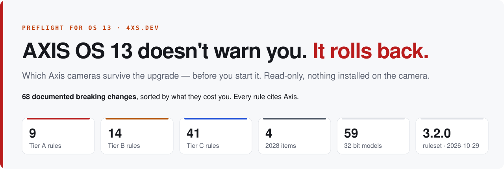

<a href="https://preflight.4xs.dev"><picture>
  <source media="(prefers-color-scheme: dark)" srcset="docs/banner-dark.svg">
  
</picture></a>

<p align="center">
  <a href="https://preflight.4xs.dev"><b>🌐 preflight.4xs.dev</b></a> &nbsp;·&nbsp;
  <a href="https://preflight.4xs.dev/#check">🔎 Check a model</a> &nbsp;·&nbsp;
  <a href="https://preflight.4xs.dev/#tiers">📋 The rules</a> &nbsp;·&nbsp;
  <a href="https://preflight.4xs.dev/rules.json">📄 rules.json</a> &nbsp;·&nbsp;
  <a href="https://preflight.4xs.dev/#scanner">📦 ACAP beta</a>
</p>

# Preflight for OS 13

**Point it at your Axis cameras. It tells you which ones will survive the AXIS OS 13 upgrade — before you start it.**

Read-only. No agent, nothing installed on the camera.

> [!IMPORTANT]
> *“If a re-installation of an ACAP results in an error… AXIS OS will initiate a rollback.”* — Axis
>
> The upgrade does not warn you and then proceed — **it fails and reverts the camera**, because of one
> application somebody installed years ago.

> [!TIP]
> **The Preflight ACAP is ready — available on request as a beta.** Install it on one camera and it
> checks the whole network. [Request it on preflight.4xs.dev →](https://preflight.4xs.dev/#scanner)

| | Part | Where | Status |
|:-:|---|---|---|
| 📋 | Ruleset + public page | this repo · [preflight.4xs.dev](https://preflight.4xs.dev) | ✅ live |
| ⌨️ | CLI scanner | [axis-cli](https://github.com/kotyzap/axis-cli) · `axis preflight` | ✅ free, open |
| 📦 | ACAP — install on one camera, checks the network | `acap/` | 🧪 beta, on request |

## 🗂️ Layout

```
rules.json     the single source of truth — 67 rules, every one citing public Axis docs
build.mjs      zero-dependency generator + validator: rules.json → dist/ (the public site)
deck.mjs       pitch deck → build/deck.html. NOT in dist/ — that directory is published.
probe-q1.sh    read-only bench probe used to verify detections against real cameras
dist/          the deployable site. Generated; do not hand-edit.
build/          internal artefacts. Not deployed.
docs/          README banners + coverage table. Generated by build.mjs; do not hand-edit.
DEPLOY.md      Cloudflare Pages settings and the pre-deploy checklist
```

The scanner lives in `axis-cli` as `axis preflight`, and bundles a copy of this
`rules.json`. See DEPLOY.md for how the two stay in sync.

One artefact, two audiences: the page renders from `rules.json`, and the scanner will read the same
file. A rule is never written twice.

## 🛠️ Build

```sh
node build.mjs   # → dist/ (index.html, rules.json, og.png, _headers, …)
node deck.mjs    # → build/deck.html
```

`build.mjs` validates `rules.json` before rendering and exits non-zero on a missing field, a
duplicate id, an unknown `source` key or an unknown `detection.method`. A broken ruleset fails the
build rather than shipping a broken page.

It also fails if `dist/` contains anything that isn't part of the public site, because Cloudflare
publishes that directory verbatim.

## 📐 Rule shape

| Field | Meaning |
|---|---|
| `id` | `A1`–`A9` blocks the upgrade · `B*` breaks the app · `C*` breaks the integration · `L*` already in force · `F*` AXIS OS 14 |
| `tier` | `A` / `B` / `C` / `future` — ordered by "would actually stop an upgrade" |
| `version` | AXIS OS version the change lands in |
| `impact` | What it does to the reader, in their terms. Not a restatement of the summary. |
| `detection.method` | `model-list` · `vapix-param` · `acap-manifest` · `eap-binary` · `client-side` · `none` |
| `detection.status` | `verified` (bench-confirmed) · `designed` (docs only) · `open` (approach unsettled) |
| `detection.blockedBy` | Which open question gates this detection |
| `source` | Key into `sources`. Every rule has one. |

Detection status: 🟢 `verified` · 🔵 `designed` · 🟡 `open`.

## 📊 Coverage

<!-- coverage:start — generated by build.mjs from rules.json; edits here are overwritten -->
| | Tier | What it does | Rules |
|:-:|---|---|--:|
| 🔴 | **A** | Blocks the upgrade or rolls it back | **9** |
| 🟠 | **B** | Upgrade succeeds, the app breaks | **13** |
| 🔵 | **C** | Camera is fine, your integration breaks (incl. 14 already in force) | **41** |
| ⚫ | **2028** | AXIS OS 14, September 2028 | **4** |
| | | **Total** · 9 bench-verified | **67** |
| 🧩 | **A5** | 32-bit models under the Y2038 ABI break | **59** |
<!-- coverage:end -->

## 📝 Changes from the original plan

Working from the Axis page directly turned up three things worth flagging:

- **C2 was overstated.** The plan asserted digest-over-HTTPS stops working by default from 12.1.
  The Axis page documents a *new authentication policy mode* called "Recommended" — not a change of
  default that disables digest. C2 is written to what the source supports and carries a
  `correctionNote`. Open question Q3 puts it on the bench.
- **The plan's ~60 undercounted.** The real page yields 66 once the already-applied 12.0/12.1 items
  and the Y2038 model lists are counted properly.
- **C24 hardened.** Password complexity is enforced by default, applies to the web interface as well
  as SSH/VAPIX/ONVIF/SNMP, and Axis states it **cannot be disabled**. Existing accounts are not
  re-validated, so the break surfaces only on new and reset devices — which is where automated VMS
  onboarding lives. Ordered first in Tier C for that reason.
- **A5's model list is exact.** 58 models, transcribed from the source. It is the cheapest
  high-value rule in the product: a string match on the model name, no probing.

Items the plan did not have and the source does: the RTSP-over-HTTP auth flip,
the VDO function and statistics removals, legacy image-rotation parameters, the Camera Tampering
detector removal, AXIS Removed Object Detection, Media Clip / Audio Mixer changes, the SSH v1 API,
`receive.cgi`, view-area behaviour, and `StreamCache.Size` on 21 non-video models.

## ❓ Open questions

Carried in `rules.json` under `openQuestions` and rendered on the page.

1. ✅ ~~**Q1** — can the probe read an installed ACAP's manifest over read-only VAPIX?~~ **Answered: no**
   — and it stopped mattering. `applications/list.cgi` already returns `CompatibleOsVersions`,
   `SignatureStatus` and `<Resources>`, which is everything A1, A4 and A8 need.
2. ❓ **Q2** — is `.eap` binary inspection in scope for v1? Blocks every `eap-binary` detection.
3. ✅ ~~**Q3** — does C2 hold?~~ **Answered: yes.** Both bench cameras refused digest and accepted
   basic-over-HTTPS, under `AuthenticationPolicy` `recommended` and `basic` alike.

## 🧭 Next

Step 1, the CLI, is done and lives in [axis-cli](https://github.com/kotyzap/axis-cli) as
`axis preflight`. Step 2, the ACAP in `acap/`, is ready and available on request as a beta;
see `acap/README.md`.

## ⚖️ Licence

[PolyForm Noncommercial 1.0.0](LICENSE). Read it, run it, change it, share it — for any
noncommercial purpose. Selling it, or building it into something you charge for, needs a separate
licence: ask at <https://preflight.4xs.dev>.

The ruleset itself (`rules.json`) cites public Axis documentation throughout and is meant to be
checked, argued with, and corrected. Issues and pull requests on the rules are the point.

---

Pavel Kotyza · [4XS.dev](https://4xs.dev) · every rule sourced from
<https://help.axis.com/en-us/axis-os#changes-in-axis-os-13>

<sub>Preflight is a personal project by Pavel Kotyza, 4xs.dev. It is not affiliated with, endorsed by or
sponsored by Axis Communications AB or CamStreamer. AXIS and AXIS OS are trademarks of Axis
Communications AB.</sub>
